# Earmark: meetings in, notes out

Earmark turns a meeting recording or a YouTube link into clean notes: a summary, to-dos with owners and dates, decisions, and open questions. Then you can **chat with the meeting** and ask what was said, who owns what, and why something was decided.

Transcription runs **locally** with Whisper. One LLM call writes the notes, and a local vector store powers the chat. Several people can use the same running instance at once, and each of them gets their own private set of meetings.

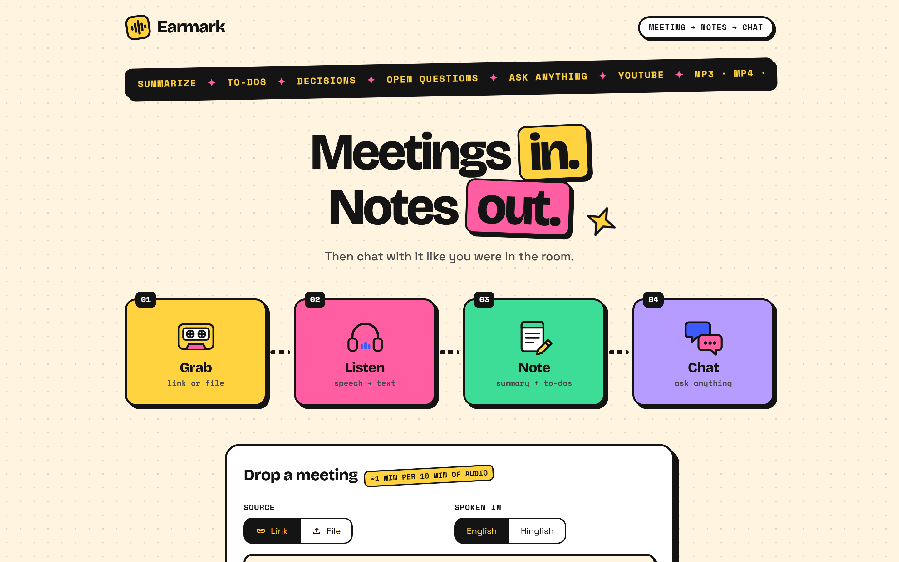

---

## Contents

- [Features](#features)
- [Screenshots](#screenshots)
- [How it works](#how-it-works)
- [Quick start](#quick-start)
- [Configuration](#configuration)
- [Usage](#usage)
- [Multiple users](#multiple-users)
- [Project structure](#project-structure)
- [Troubleshooting](#troubleshooting)
- [Known limitations](#known-limitations)

---

## Features

- **YouTube link or local file**: mp3, wav, m4a, mp4, mkv, mov, webm, ogg, flac, aac (up to 1 GB).
- **Local speech-to-text** with [OpenAI Whisper](https://github.com/openai/whisper). Audio never leaves your machine for transcription.
- **Structured notes in one LLM call**: title, bullet summary, action items (task, owner, deadline), key decisions, open questions.
- **Chat with the meeting (RAG)**: answers are grounded only in the transcript and stream in as they're written.
- **Live progress**: four stages (Grab → Listen → Note → Chat) with a percentage and a per-part counter for long recordings.
- **Caching**: the same video or file is never transcribed or analyzed twice, for any user.
- **Switch LLM provider from `.env`**: Groq or OpenAI, with any model name.
- **Download notes** as a Markdown file.
- **Command-line mode** (`python main.py`) for terminal use.

---

## Screenshots

### Live progress: every stage is visible

| Grab | Listen |
|---|---|
| 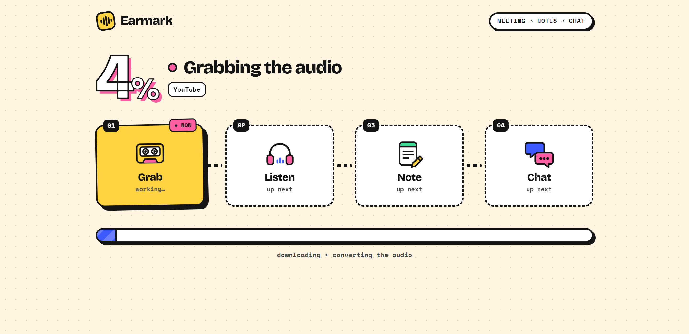 | 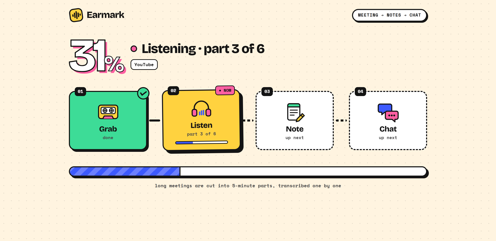 |
| **Note** | **Chat** |
| 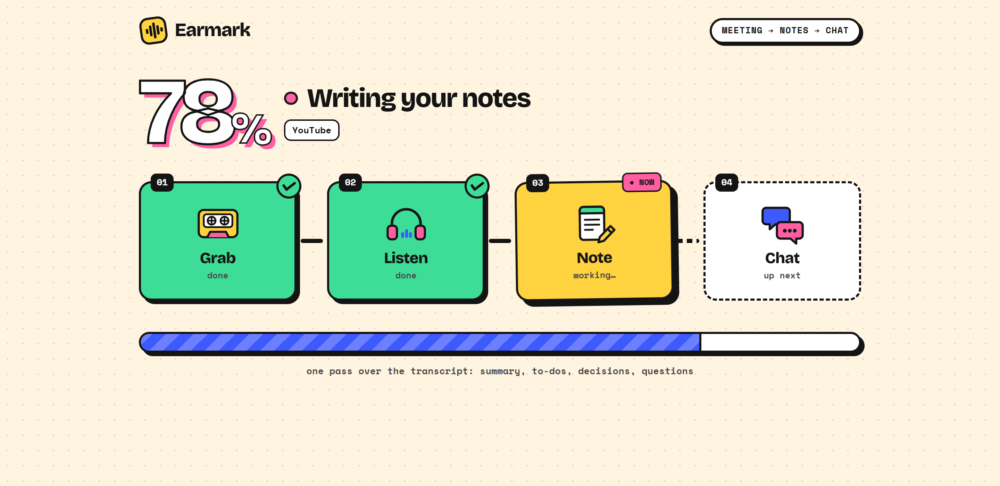 | 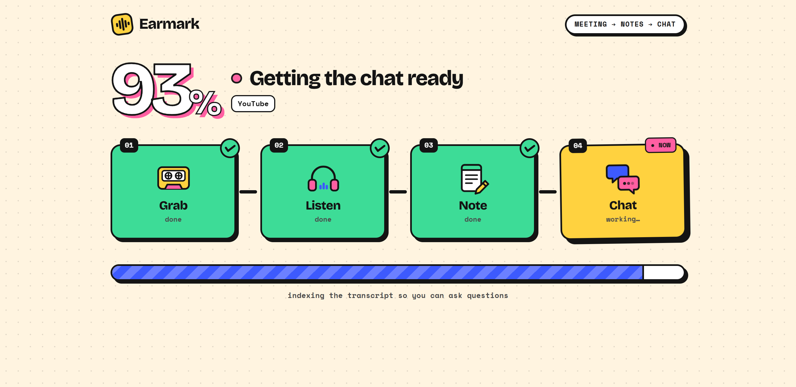 |

When another user's meeting is being transcribed, yours waits in line, and the page says so:

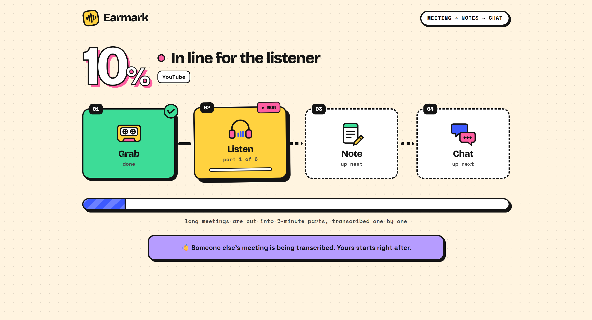

### Notes + chat

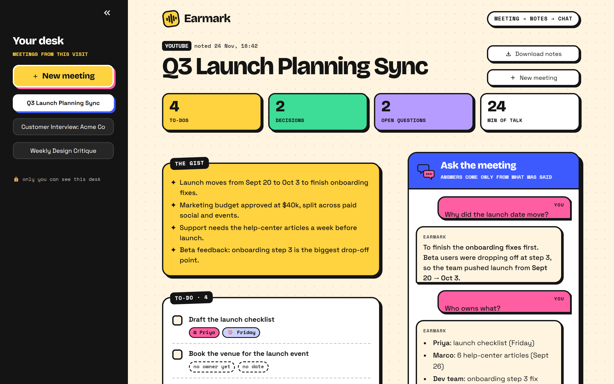

<details>
<summary>Full meeting page</summary>

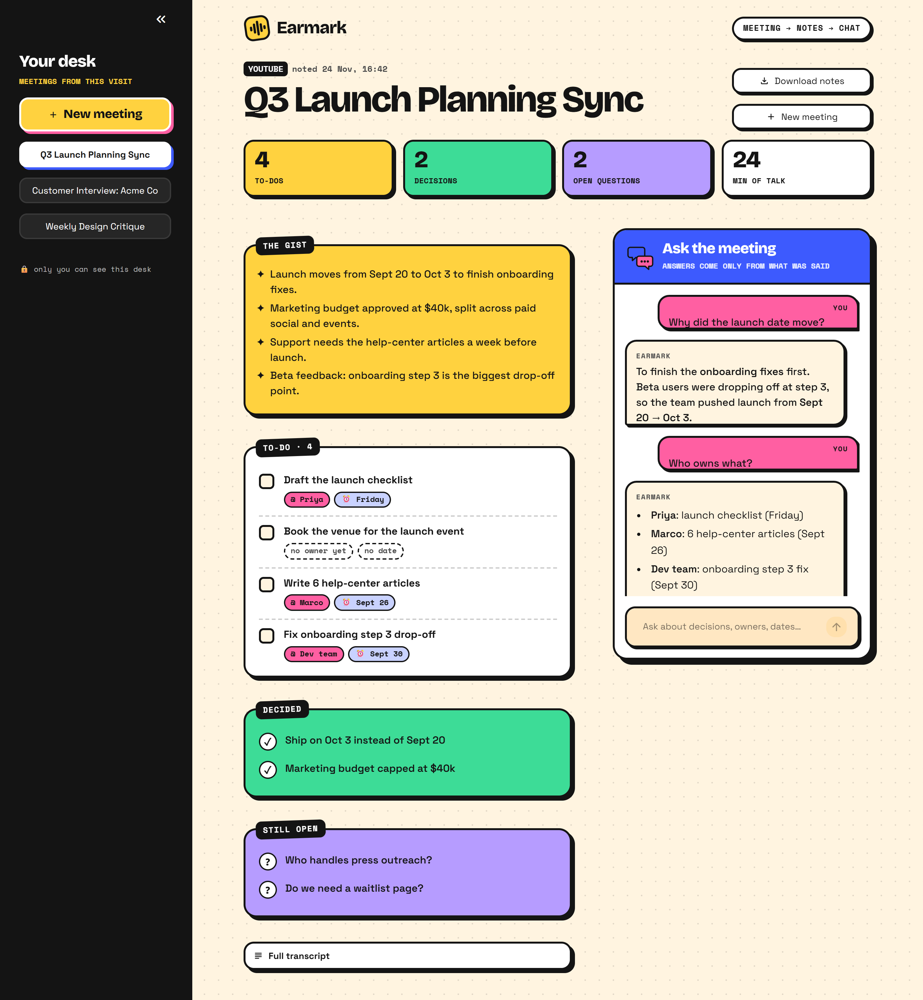

</details>

<p align="center">
  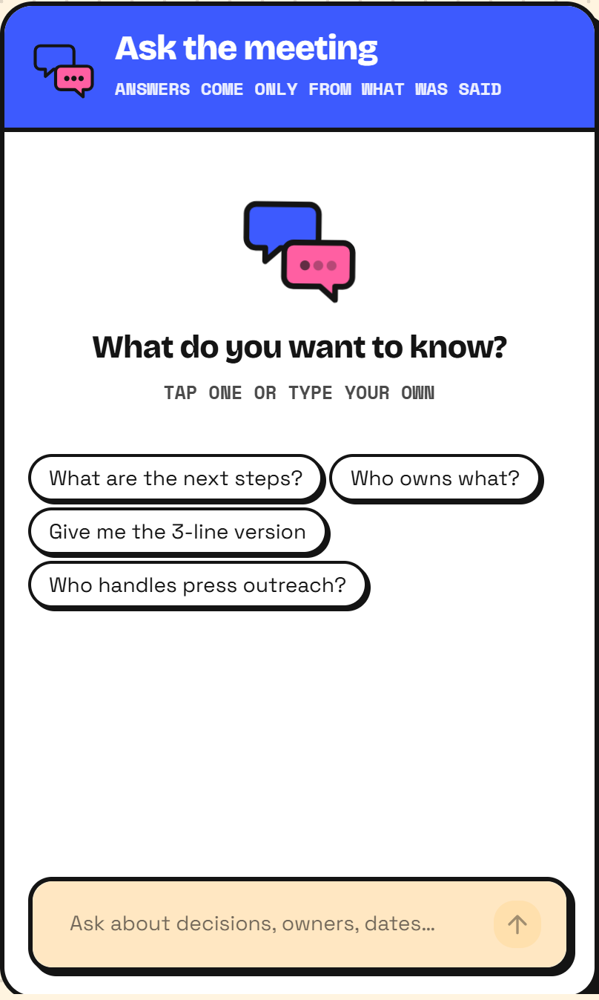
  &nbsp;&nbsp;
  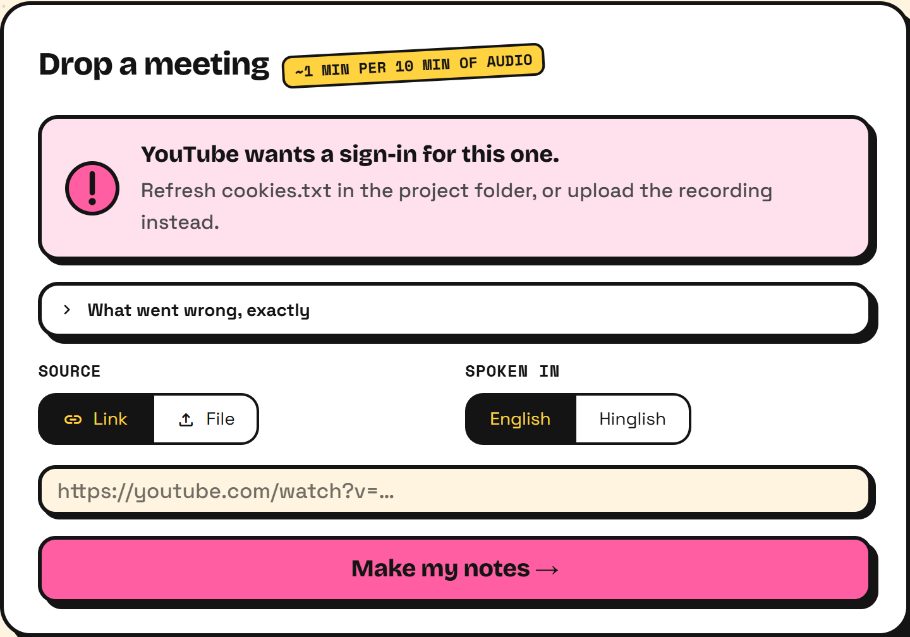
</p>

### Mobile

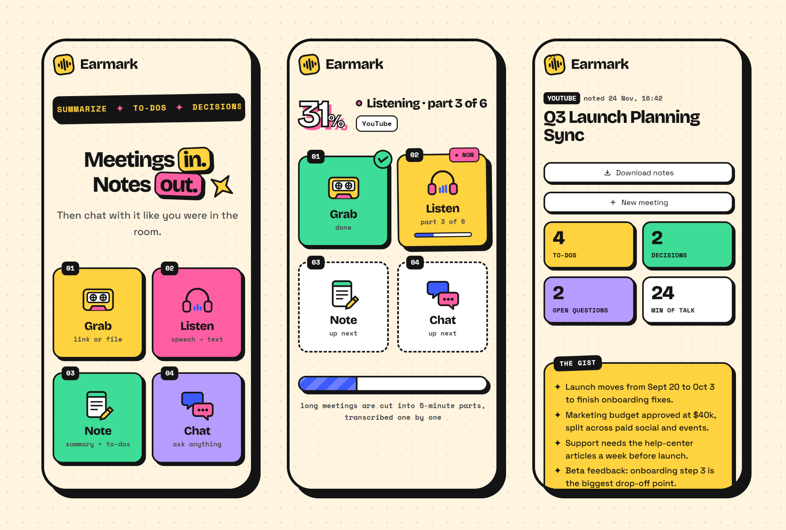

---

## How it works

```
 YouTube URL ──► yt-dlp ──┐
                          ├──► 16 kHz mono WAV ──► 5-min chunks ──► Whisper (local) ──► transcript
 Local file ──► ffmpeg ───┘                                                                │
                                                                                           ▼
                                                               cache (.temp/cache/<key>.json)
                                                                                           │
                         ┌─────────────────────────────────────────────────────────────────┤
                         ▼                                                                 ▼
          LLM (Groq / OpenAI), structured output                  split 500-char chunks ──► MiniLM embeddings
          title · summary · to-dos · decisions · questions                                  │
                         │                                                                 ▼
                         ▼                                              Chroma (vector_db/, one collection per meeting)
                    notes page                                                             │
                                                                                           ▼
                                                                   chat: top-4 chunks + question ──► LLM ──► answer
```

| Stage | What happens | Code |
|---|---|---|
| **Grab** | YouTube audio is downloaded with `yt-dlp`, or the uploaded file is converted to WAV. Audio is cut into 5-minute chunks. | [`utils/audio_processor.py`](utils/audio_processor.py) |
| **Listen** | Each chunk is transcribed by a local Whisper model. | [`core/transcriber.py`](core/transcriber.py) |
| **Note** | The whole transcript goes to the LLM **once** and comes back as a typed `MeetingAnalysis` object. Very long transcripts are split into parts and then merged. | [`core/analyzer.py`](core/analyzer.py) |
| **Chat** | The transcript is embedded into Chroma. Each question retrieves the 4 most relevant chunks and the LLM answers from those only. | [`core/vector_store.py`](core/vector_store.py), [`core/rag_engine.py`](core/rag_engine.py) |

### LLM calls per meeting

| Situation | Calls |
|---|---|
| Transcript ≤ `LLM_MAX_CHARS` (default 20k chars, about 20 min of speech) | **1** |
| Longer transcript | one per part + 1 merge (a 1-hour meeting is about 4) |
| Same video or file again | **0** (served from cache) |
| Each chat question | 1 |

---

## Quick start

### 1. Prerequisites

| Tool | Why | Install |
|---|---|---|
| **Python 3.10+** | runs the app | [python.org](https://www.python.org/downloads/) |
| **FFmpeg** | audio conversion for Whisper and pydub | Windows: `winget install Gyan.FFmpeg` · macOS: `brew install ffmpeg` · Linux: `sudo apt install ffmpeg` |
| **Deno** | lets `yt-dlp` solve YouTube's JavaScript check | Windows: `winget install DenoLand.Deno` · macOS/Linux: `curl -fsSL https://deno.land/install.sh \| sh` |
| **API key** | Groq (free tier) or OpenAI | [console.groq.com](https://console.groq.com/keys) · [platform.openai.com](https://platform.openai.com/api-keys) |

Deno is only needed for YouTube links. Local files work without it.

### 2. Install

```bash
git clone https://github.com/FireIndex/earmark-ai.git
cd earmark-ai

python -m venv .venv
# Windows
.venv\Scripts\activate
# macOS / Linux
source .venv/bin/activate

pip install -r requirements.txt
```

> Whisper installs PyTorch. If you have an NVIDIA GPU, install the CUDA build of PyTorch first ([pytorch.org](https://pytorch.org/get-started/locally/)) for much faster transcription.

### 3. Configure

Copy the template and fill in your key:

```bash
cp .env.example .env        # Windows: copy .env.example .env
```

The important lines:

```ini
# LLM: pick one provider
LLM_PROVIDER=groq
LLM_MODEL=openai/gpt-oss-20b
GROQ_API_KEY=gsk_...

# LLM_PROVIDER=openai
# LLM_MODEL=gpt-4o-mini
# OPENAI_API_KEY=sk-...

# Whisper model: tiny | base | small | medium | large
WHISPER_MODEL=small
```

### 4. Run

```bash
streamlit run app.py
```

Open http://localhost:8501.

The first run downloads the Whisper model (about 460 MB for `small`) and the embedding model (about 90 MB). Later runs start quickly.

---

## Configuration

All settings live in `.env`.

| Variable | Default | Description |
|---|---|---|
| `LLM_PROVIDER` | `groq` | `groq` or `openai` |
| `LLM_MODEL` | `openai/gpt-oss-20b` (Groq) · `gpt-4o-mini` (OpenAI) | Any chat model your provider offers |
| `GROQ_API_KEY` | none | Required when `LLM_PROVIDER=groq` |
| `OPENAI_API_KEY` | none | Required when `LLM_PROVIDER=openai` |
| `LLM_MAX_CHARS` | `20000` | Largest transcript sent to the LLM in one call. The default fits Groq's free-tier tokens-per-minute limit. On a paid plan, set `200000` so even long meetings take 1 call. |
| `WHISPER_MODEL` | `small` | `tiny` / `base` (fast, less accurate) to `medium` / `large` (slow, most accurate) |
| `YTDLP_COOKIES_FILE` | `cookies.txt` in the project root, if present | Netscape-format cookies for YouTube videos that require sign-in |
| `YTDLP_COOKIES_BROWSER` | none | Read cookies straight from a browser (`firefox`, `chrome`, `edge`, `brave`). Close the browser first. |

### Switching to OpenAI

```bash
pip install langchain-openai   # already in requirements.txt
```

```ini
LLM_PROVIDER=openai
LLM_MODEL=gpt-4o-mini
LLM_MAX_CHARS=200000
```

Cached notes are not tied to a model. To regenerate a meeting's notes with the new model, delete its file in `.temp/cache/`.

---

## Usage

### Web UI

1. Choose **Link** or **File**, and the spoken language.
2. Paste a YouTube link or drop a recording, then click **Make my notes →**.
3. Watch the four stages fill in.
4. Read the notes, click a suggested question or type your own, and **Download notes** as Markdown.

Your meetings from this visit are listed on the left under **Your desk**.

### Command line

```bash
python main.py
```

```
Enter YouTube URL or local file path: https://www.youtube.com/watch?v=...
Language (english/hinglish): english
...
📌 Title: Q3 Launch Planning Sync
📋 Summary: ...
💬 Chat with your meeting (type 'exit' to quit)
You: who owns the checklist?
```

### As a library

```python
from main import run_pipeline

result = run_pipeline("meeting.mp3", on_step=lambda step, detail: print(step, detail))
print(result["title"], result["action_items"])
print(result["rag_chain"].invoke("What was decided about the budget?"))
```

---

## Multiple users

Earmark is built so several people can share one running instance (for example, on a LAN or an internal machine).

| Concern | How it's handled |
|---|---|
| **Privacy between users** | Meetings and chat history live in each browser session (`st.session_state`). Nobody sees anyone else's desk. |
| **One Whisper model, many jobs** | The model is loaded once and shared. Jobs take turns through a lock, and waiting users see a "Yours starts right after" message instead of a frozen page. |
| **Duplicate work** | Results are cached by YouTube video ID or by the **content hash** of an uploaded file, so a recording one person already processed is instant for everyone, whatever the file is called. |
| **Chat isolation** | Each meeting gets its own Chroma collection, so answers never mix meetings. |

---

## Project structure

```
.
├── app.py                  # Streamlit UI (home → progress → notes + chat)
├── main.py                 # run_pipeline() + command-line entry point
├── core/
│   ├── llm.py              # picks Groq/OpenAI from .env, shared client with retries
│   ├── analyzer.py         # one structured LLM call → MeetingAnalysis
│   ├── transcriber.py      # local Whisper, shared model + queue lock
│   ├── vector_store.py     # Chroma + MiniLM embeddings, one collection per meeting
│   └── rag_engine.py       # retrieval-augmented chat chain
├── utils/
│   ├── audio_processor.py  # yt-dlp download, ffmpeg conversion, 5-min chunking
│   └── cache.py            # transcript + notes cache keyed by video ID / file hash
├── ui/
│   ├── style.css           # the whole look (no "<" allowed, see below)
│   └── art.py              # icons as SVG data-URL images (animated with SMIL)
├── .streamlit/config.toml  # theme, 1 GB upload limit, minimal toolbar
├── docs/screenshots/       # images used in this README
└── requirements.txt
```

Generated at runtime (git-ignored): `.temp/` (downloads, chunks, uploads, cache) and `vector_db/` (Chroma).

### A note for contributors on styling

`st.html` sanitizes its input:

- **Inline `<svg>` is stripped.** Icons are therefore served as ``. See `ui/art.py`.
- **A `<style>` block containing a `<` character is dropped entirely.** `app.py` raises an error if `ui/style.css` ever contains one.
- Segmented controls and pills don't have `data-testid`s. Target them with `button[data-variant="segmented_control"]` and `[data-selected="true"]`.

---

## Troubleshooting

| Symptom | Fix |
|---|---|
| **"YouTube wants a sign-in for this one"** / "confirm you're not a bot" | Export fresh cookies from a logged-in browser to `cookies.txt` in the project root (Netscape format, e.g. with the "Get cookies.txt LOCALLY" extension), or set `YTDLP_COOKIES_BROWSER`. You can also upload the file instead. |
| **"Requested format is not available"** | Install Deno and make sure it's on your `PATH`. `yt-dlp` needs it for YouTube's JavaScript check. |
| **"Whoa, too fast" / HTTP 429** | You hit the provider's rate limit. Wait a minute. On Groq's free tier, keep `LLM_MAX_CHARS` at 20000 or lower. |
| **"The API key didn't work"** | Check that the key in `.env` matches `LLM_PROVIDER`. |
| **"Couldn't open that recording"** / ffmpeg errors | Install FFmpeg and confirm `ffmpeg -version` works in a new terminal. |
| **Notes didn't change after switching models** | They're cached. Delete the meeting's file in `.temp/cache/`. |
| **Transcription is slow** | Use `WHISPER_MODEL=base` or `tiny`, or install CUDA PyTorch on a GPU machine. |
| **Want a clean slate** | Delete `.temp/` and `vector_db/`. Both are recreated automatically. |

---

## Known limitations

- **Hinglish** can be selected, but it currently goes through the same Whisper path as English. A dedicated Hinglish→English transcriber (e.g. Sarvam) is stubbed in `core/transcriber.py` but not wired up yet.
- Chat history lives in the browser session and is lost on page refresh. Notes and transcripts are cached on disk, so reprocessing the same recording is instant.
- Whisper runs on CPU unless a CUDA build of PyTorch is installed.
- This project is designed to run locally or on a private machine. It has no login system, so don't expose it to the public internet as is.
